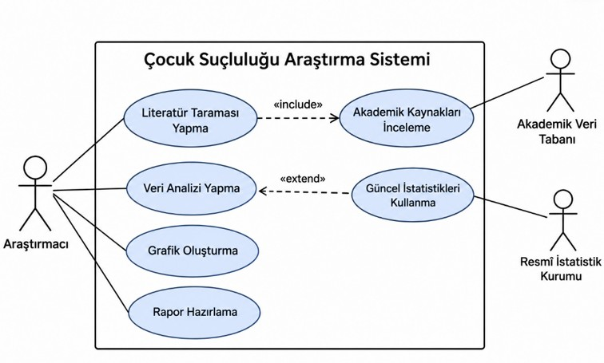
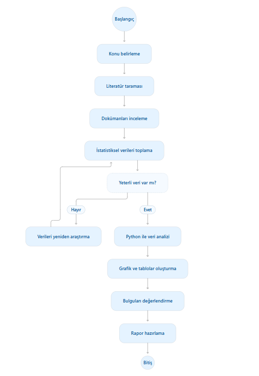
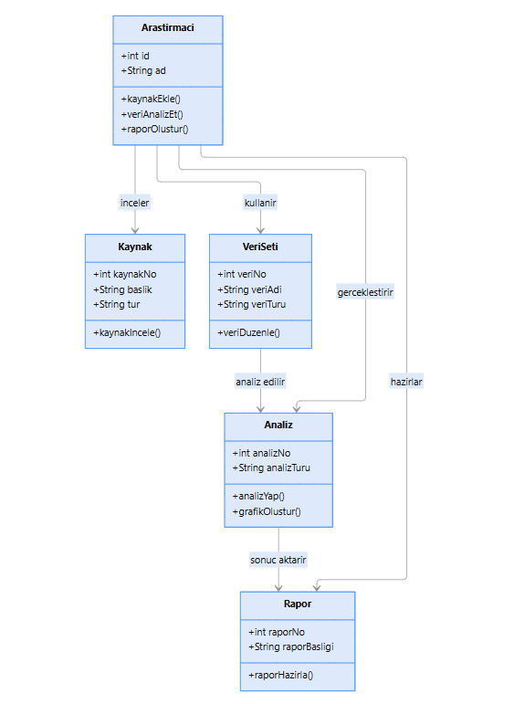

# Çocuk Suçluluğunun Nedenleri, Risk Faktörleri ve Önleme Stratejilerinin İncelenmesi

## Proje Hakkında

Bu proje, çocuk suçluluğunun nedenlerini, risk faktörlerini ve önleme stratejilerini incelemeyi amaçlamaktadır.

## Projenin Amacı

Çocukların suça sürüklenmesinde etkili olabilecek bireysel, ailesel ve çevresel faktörleri araştırmak ve elde edilen bilgileri değerlendirmek.

## Araştırma Soruları

- Çocukların suça sürüklenmesinde hangi faktörler etkilidir?
- Çocuk suçluluğunu açıklayan temel teoriler nelerdir?
- Çocuk suçluluğuyla ilişkili risk faktörleri nelerdir?
- Türkiye'de çocuk suçluluğunun güncel durumu nasıldır?
- Çocuk suçluluğu nasıl önlenebilir? 

## Kullanılacak Yöntem

- Literatür taraması
- Doküman analizi
- İstatistiksel verilerin incelenmesi
- Python ile veri analizi ve görselleştirme

## Veri Kaynakları

Akademik makaleler, bilimsel araştırmalar ve uygun resmî istatistikler.

## Proje Durumu

Proje konusu belirlenmiştir. Literatür taraması ve uygun veri kaynaklarının belirlenmesi planlanmaktadır.

## UML Diyagramları

Projenin sistem yapısını ve çalışma aşamalarını açıklamak amacıyla üç UML diyagramı hazırlanmıştır.

### 1. Use Case (Kullanım Durumu) Diyagramı

Araştırmacının sistem içerisinde gerçekleştirebileceği işlemleri ve sistemle etkileşimlerini göstermektedir.

### 2. Activity (Etkinlik) Diyagramı

Araştırmanın konu seçiminden rapor hazırlanmasına kadar ilerleyen aşamalarını ve karar noktalarını göstermektedir.

### 3. Class (Sınıf) Diyagramı

Sistemde yer alan sınıfları, bu sınıfların özelliklerini, metotlarını ve birbirleriyle olan ilişkilerini göstermektedir.

## Veri Analizi (6. Hafta)

Bu aşamada çocuk suçluluğuna ilişkin TÜİK tarafından yayımlanan 2024-2025 yılı istatistikleri Python kullanılarak analiz edilmiştir.

### Kullanılan Teknolojiler
- Python
- Pandas
- Matplotlib
- Google Colab

### Yapılan Çalışmalar
- TÜİK verileri CSV formatında aktarılmıştır.
- Veri tabloları incelenmiş ve eksik değer kontrolü yapılmıştır.
- Toplam olay sayısı, yıllık ortalama ve yüzde değişim hesaplanmıştır.
- 2024 ve 2025 yıllarına ait veriler karşılaştırılmıştır.
- İki farklı grafik oluşturulmuştur.
- Analiz sonuçları CSV, grafikler PNG formatında kaydedilmiştir.

### Veri Kaynağı
Türkiye İstatistik Kurumu (TÜİK) – Güvenlik Birimine Gelen veya Getirilen Çocuk İstatistikleri (2024-2025).

### Çalışma Sonuçları
2025 yılında suça sürüklenme şüphesiyle güvenlik birimine getirilen çocuklara ilişkin olay sayısı, 2024 yılına göre yaklaşık %3,19 azalmıştır. Suç türlerine göre oranlar da karşılaştırılarak grafiklerle gösterilmiştir.

Çalışma bireysel olarak yürütülmüştür.
